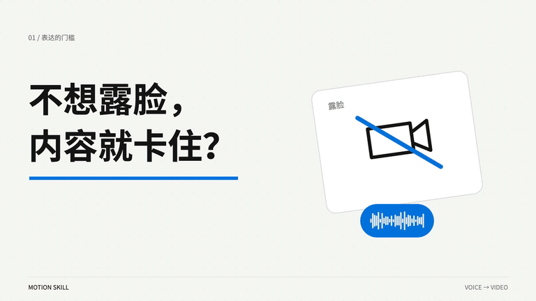
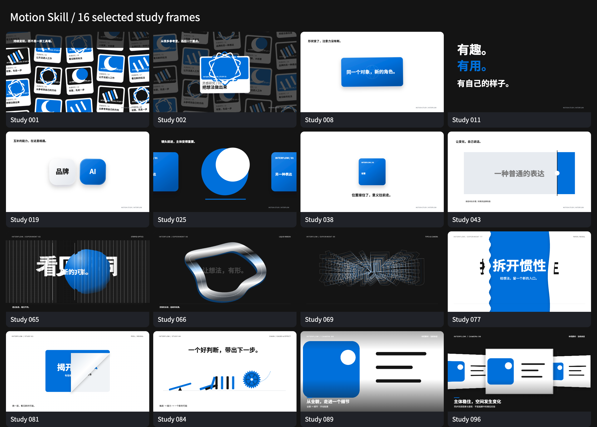

# Motion Skill — 不出镜，也能把想法做成视频

**给有想法、想表达，但不想出镜的人：用文案或录音，让观点通过画面与动效被看见。**

Motion Skill 是给 Codex / Agent 使用的 **voice-to-video Skill 与可编辑 Remotion 工程**，支持按文稿编排无口播动效，也支持将已有录音编排成视频。默认 **16:9**，当前为**公开测试版**。具体版本与变更保留在[更新日志](CHANGELOG.md)。

[本次 Release](https://github.com/derek-zhuolin/motion-skill/releases/tag/v1.2.0-beta.1) · [安装与更新](docs/UPDATING.md) · [更新日志](CHANGELOG.md) · [English overview](README.en.md) · [快速开始](docs/GETTING_STARTED.md) · [提示词](docs/PROMPTS.md) · [常见问题](docs/FAQ.md) · [内测反馈 / 参与贡献](CONTRIBUTING.md)

## 本次更新：工程化编排与音乐律动

**先让画面表达清楚，再让动作跟音乐呼吸。** 新增能力都是可选扩展，不重写旧工程或替换已选风格。

1. **工程断点**：重点运镜与交接检查；显式文件指纹检测旧产物/旧音轨报告；计划、接线、画面、播放、用户认可分开记录。
2. **编排与保真**：同一命名事件表生成镜头表与风险窗口；过程不冒充完成；新增人工选音乐起音的律动 helper，支持分组、停顿和镜头变化。
3. **公开案例与迁移**：无私人内容的发票/库存两变体 Playground，保留旧 reference 和10个稳定 adapter；新扩展按项目选择启用。

[三步升级与实际边界](docs/ORCHESTRATION_UPGRADE.md) · [律动 Playground 源码与启动](examples/rhythm-playground/README.md) · [下载预构建试验包（约0.9 MB）](https://github.com/derek-zhuolin/motion-skill/releases/download/v1.2.0-beta.1/motion-rhythm-playground.zip) · [编排合同](references/orchestration-contract.md) · [本版验证](verification/1.2.0-beta.1.md)

```sh
# 在仓库根目录；复用已安装且版本匹配的依赖则跳过 npm ci
npm ci
npm run build:rhythm
npm run preview:rhythm
# 浏览器打开 http://127.0.0.1:4343
```

示例含可播放、可拖动的同时间轴对照；音源为源码生成的 **116 BPM 测试节奏，并非 ACE-Step 作品**。它验证可复现的编排与时间，不承诺用户成片品质。

### 想自己生成配乐？可选安装 ACE-Step

[ACE-Step 官方 GitHub](https://github.com/ace-step/ACE-Step-1.5) · [官方中文安装指南](https://github.com/ace-step/ACE-Step-1.5/blob/main/docs/zh/INSTALL.md) · [配合 Motion 使用 / 复制给 Agent 的提示词](docs/ACE_STEP.md)

ACE-Step 用于本地生成音乐，Motion Skill 负责画面与动作编排。**程序与模型由使用者从官方来源自行安装；安装或更新 Motion Skill 不会同时安装 ACE-Step。** 已装好可复用，有现成授权音乐可跳过安装。

> **第一次模型下载较大，可能等很久，请提前留出时间与磁盘空间。** 官方指南列出核心模型约 **10GB 磁盘需求**，另有依赖和缓存；这不是固定下载量。首次下载可能需要几十分钟或更久，取决于网络和所选模型。下载、首次加载、生成音乐是不同的等待，后续通常可复用模型缓存。先看下载进度或日志，不要把仍在下载误判为卡死。

装好后先生成短样本试听，再安排画面和独立动作音效。具体步骤、等待说明与效果边界见 [ACE-Step 使用说明](docs/ACE_STEP.md)。

## 先看 reference 效果

[](https://github.com/derek-zhuolin/motion-skill/releases/download/v1.1.0-beta.1/motion-skill-reference.mp4)

**上方是48秒循环动图预览（静音）。**

### ▶ [下载完整有声视频 · 1080p / 48秒 / 中文字幕](https://github.com/derek-zhuolin/motion-skill/releases/download/v1.1.0-beta.1/motion-skill-reference.mp4)

[视频发布页](https://github.com/derek-zhuolin/motion-skill/releases/tag/v1.1.0-beta.1) · [仓库内的MP4原文件](demo/motion-skill-reference.mp4) · [可编辑reference工程](examples/voice-to-video/README.md)


**96 项动效机制研究 · 19 个分类 · 10 个生产组件 · 5 类语义结构 · 48 秒有声 reference**

这是一套给 Codex / Agent 使用的 Skill 和 Remotion 工程。它组织原声、实拍素材、字幕与 Motion Graphics；由 Agent 理解内容并编排镜头，Python 负责时间与约束检查，Remotion 负责预览和导出。

本 reference 在 **Codex + GPT-6.1 Sol** 中完成（模型名称按作者提供的标注），本地 Whisper 负责转写，Remotion 负责画面渲染。作者参与了视觉方向、实拍补充、ending 与字幕的反馈。它是一个真实迭代案例，不是“一条 prompt 保证任意音频全自动成片”的能力承诺。

## Motion Skill 更新｜更连贯的动效编排

**默认读取 Remotion Best Practices → 提前展示编号镜头表 → 按内容选动效 → 先看 15–20 秒样片。**

- **规范默认读取**：涉及 Remotion 实现时，Agent 先定位并阅读官方 `remotion-best-practices` 入口，再读与本次任务有关的分支，无需重复提醒。定位器只报告文件、版本与 hash；找到文件不等于已读或已遵循。缺失会说明，不静默联网安装。
- **编排提前可见**：实现前展示每镜的时间、意思、主焦点、主效果研究编号与组件名、辅助转场、交接对象、选择原因和阅读窗口。它是开工说明，不新增逐镜审批。
- **内容决定效果**：数字快照可滚动落定或固定揭露；两期变化须有两份可比证据；关键词建立阅读层级；真实素材在原图内部取景与圈注；原视频已有动作时保持外框稳定。记录近期实际用过的机制，减少机械重复，不随机抽效果、不固定重放 AME 镜头。
- **保留已选视觉**：字体、字号角色、配色、材质、阴影和素材表现沿用已选基准；按当前内容调整动效选择与衔接路径。数字组件保留边缘渐隐、轻微模糊与分隔符外观，通用组件不能以“升级”为由换掉原片质感。
- **先样片**：默认 15–20 秒，用户确认表达、可读性与连续性后再扩展；明确要求其他时长或直接整片时按本次要求。技术通过不代替用户验收。

**96 项研究 ≠ 96 套生产模板。** 当前有 **10 个可导入基础组件**（[实际清单](references/production-registry.json)），包括数字滚动、固定数值揭露、数值对照、逐行揭露、素材内部取景、圈注、焦点交接，以及原有关键词窗口、词组节奏、粘土汇合。复杂关系仍需 Agent 定制。

| 镜头与时间（说明性示例） | 内容与焦点 | 主效果 | 辅助 / 交接 | 为什么用 / 阅读窗口 |
|---|---|---|---|---|
| S01 · 0–4s | 已核验的当前数字 | #35 NumberReel | #36 圈注来源；#38 交给证据区域 | 强调这个快照；不是增长曲线。完整显露后保留 1.6–3.5s 供读数 |
| S02 · 4–9s | 截图中的对应证据 | #27 MediaFocus | 同一注视框留在来源上 | 找到原文位置；读字时画面稳定，5–8.5s 阅读 |
| S03 · 9–16s | 一个短结论 | #31 LineReveal | 有关联才承接，无关联直接切镜 | 先结论后细节；10–15s 阅读与落定 |

这些时间仅演示记录方法，不是通用镜头模板，也不是读者实测标准。脚本输入示例 [semantic-plan.example.json](assets/semantic-plan.example.json) 使用显式测试数据；实际来源、阅读时间和转场由本片内容决定。

### 两套 Skill 与一个运行时

| 层 | 负责什么 |
|---|---|
| Motion Skill | 内容判断、镜头选型、阅读时间、对象交接、验收记录 |
| 官方 Remotion Agent Skills | React 视频、时间轴、素材与 Studio 的实现规范 |
| Remotion npm 依赖 | 实际预览与渲染；版本继续固定为 4.0.538 |

首次使用，先按下文安装本仓库，再通过官方命令安装 Remotion Agent Skills：

```sh
npx skills add remotion-dev/skills
```

这条命令会联网安装到所选 Agent 环境，由使用者主动运行；Motion Skill 不自动替你安装。官方 Skill 正文不随本仓库分发。参考 [官方说明](https://www.remotion.dev/docs/ai/skills) 和 [接入边界](references/remotion-integration.md)。不同 Agent 的安装目录可能不同，可用 `--skills-root` 指定。

```sh
# 以下在 motion-skill 仓库根目录运行，输出使用新路径
python3 scripts/motion.py preflight-remotion --project /absolute/project
python3 scripts/motion.py select-motion assets/semantic-plan.example.json \
  --out /tmp/motion-selection.json --explain /tmp/motion-shots.md
```

`select-motion` 接收 **Agent 已核对的语义、来源、素材用途和阅读窗口**，不是原始音视频识别模型，也不会自动改写影片。输出是 `planned_not_wired`；实际导入与调用后另存使用清单、做源码检查和画面复看。未覆盖的关系可以按目录做 custom 实现，不为通过选择器而扭曲内容。详见 [内容到镜头](references/semantic-orchestration.md) 和 [接入组件](references/production-pipeline.md)。

[本地复用与转写缓存](references/local-fastpatch.md) 只保存于使用者本机；公开包没有作者的私人基准、录音或缓存。没有自己的基准时，从新工程或已有公开 reference 开始，不能宣称已复刻私人 AME 原片。

## 适合谁

你可能有很多想法，也愿意分享自己的观察，却总卡在“要不要露脸、怎么拍、怎么剪”这一步。可以先拿手机把话说出来，再让 Codex 配合 Motion Skill 把声音组织成画面。

- **不想出镜的创作者**：用自己的声音分享观点、知识或生活观察。
- **有产品想法的设计师、开发者与独立创作者**：用流程动效、真实截图或实拍解释一个问题与解决方式。
- **习惯先说再写的人**：把一段核对过的语音整理成可观看、可继续修改的视频。

你负责内容、判断与最终确认，Agent 协助编排和实现。无需拍摄自己的脸；已有录音是最直接的起点。**不出镜不等于匿名**，声音及讲述内容仍可能识别身份；公开前请确认发布范围。

只看效果可以直接下载视频；制作自己的片子需要 Codex 或其他能读写工程、运行命令的 Agent，以及下方列出的本地环境。

## 不录音也能做；声音按需要选择

录音不是必填项。已有 `script` 文稿模式可按文案、目标时长与阅读预算编排文字、图形、流程和片尾；没有音源时输出静音画面。`example` 是另一个模式，用于明确标注的结构演示，不代表完成了你的内容。

| 内容选择 | 当前工程的实际状态 |
|---|---|
| 只有文案，不录音 | 支持 `script` 模式，需 Agent 编排镜头与布局 |
| 录音＋动效 | 支持 `voice` 模式，原声1×，默认要求同步字幕 |
| 动效音效（点击、滑动、落定等） | 可作为制作要求；新工程支持显式 `--audio-kind sfx` 输入；无内置音效库、独立开关或自动配音效，落点与混音需另做 |
| 背景音乐 | 可作为制作要求；新工程支持显式 `--audio-kind music` 输入；需另行选曲、确认许可并混音，不自动添加 |

**不录口播 ≠ 必须无声，录了口播 ≠ 不能加音效。** 口播、动效音效、背景音乐是三个可分别选择的声音层。当前默认不自动添加音效或音乐；有需要请在提示词中明确，实际工程仍需实现与听检。

本次48秒reference只接入口播，实拍视频静音，没有额外添加音效或背景音乐。播放器的“原声开/关”只控制口播，不是音效选择器；首页GIF本身也不含声音。详见[声音说明](docs/AUDIO.md)。

## 效果与工程索引

- [25 条同步字幕 SRT](examples/voice-to-video/captions.srt)
- [96 项机制目录、分类与缩略图](docs/EFFECTS.md)
- [来源与参考者署名](ATTRIBUTION.md) · [许可范围](LICENSE_SCOPE.md)



上图是机制的单帧示意；在本地打开 `studies.html` 可逐项播放 96 项研究。它们是二维/SVG/CSS 研究和近似效果，不是 96 项全新发明，也不是本片用了 96 个效果。

## 可直接复制的提示词

> /motion-video 我不想出镜，但想分享这段录音里的观点。把这段音频做成“实拍素材混剪＋MG 动效”：具体场景用实拍，抽象关系用动效。保留原声 1×，补上同步底部字幕。没有实拍素材时，请 Codex 按口播场景联网寻找并下载有明确使用许可的公开素材，保留作者与来源。片尾放大 **[名称]**，配 **[收尾文案]**，稳定停留至少三秒。完成后导出有声 MP4 和可编辑工程。

更完整的输入、素材与 ending 模板见 [PROMPTS](docs/PROMPTS.md)。尽量给出受众、唯一带走的结论、画幅和想要的片尾。没有仓库链接就不编造链接。

## 画幅：默认16:9，需要时在提示词里指定

**不写比例时，默认横屏16:9。** 需要其他画幅时，在提示词中明确写出目标比例；也可以同时给出成片像素尺寸。

| 提示词中的要求 | 示例成片尺寸 | 排版方向 |
|---|---|---|
| 未指定比例，或“使用16:9横屏” | 1920×1080 | 横向展开 |
| “改成9:16竖屏” | 1080×1920 | 标题、画面与字幕上下重排 |
| “改成3:4竖版” | 1080×1440 | 收紧纵向留白，保留独立字幕区 |

可直接追加：

> 这条改成 **9:16竖屏，1080×1920**。请按竖屏重新排标题、实拍、动效、字幕和ending，保留原声1×。

或：

> 这条改成 **3:4竖版，1080×1440**，按这个比例重新组织构图与字幕安全区。

当前通用运行模板仍固定为16:9；9:16、3:4等是交给Codex的目标画幅要求，需要相应调整工程与布局后验证，不是只改比例数字就自动适配的现成开关。其他比例也请写清宽:高，必要时给出像素尺寸。详见[画幅与版式](docs/CUSTOMIZATION.md#字幕与画幅)。

## 没有实拍素材，也可以让 Codex 找

可以在提示词里直接说：

> 我没有现成的实拍素材。请你根据口播里的具体场景，联网搜索并下载有明确使用许可的真实照片和短视频，优先使用可用的公开素材库。自行选取合适片段并静音，记录作者、原始页面和许可证，再接入工程。不需要我逐张挑选。

Codex需要有可用的联网搜索/下载能力；Skill本身没有内置素材搜索API。来源不清、付费或下载受限时，说明缺口，不把示意图或AI生成画面标成实拍，也不自动购买。本reference就采用了从公开来源获取的工作台照片和手机实拍视频，详见[制作记录](docs/REFERENCE.md)。

## 工程里有什么

| 内容 | 核对后的数量 / 状态 |
|---|---|
| 机制研究 | **96 项，19 类**，目录按 ID 对应源码 |
| 可导入生产组件 | **10 个**；逐个记录实现与研究编号，不自动装配成影片 |
| 通用语义 renderer | **5 类**：collect / connect / compare / evidence / conclusion |
| 导演与工程能力 | [12 项能力矩阵](docs/FEATURES.md)，逐项标明通用模板 / reference / 限制 |
| 本 reference | **7 段语义镜头、25 条字幕、1 张实拍照片、5.4 秒实拍视频** |
| 原声与输出 | 原声 48.064s、1×；1920×1080、30fps、H.264/AAC |
| 历史组合 | 目录保留历史组合记录；当前研究 UI 不开放它们，不计入可用模板数 |

## 运行 reference

准备 Node.js 22+、Python 3、FFmpeg 与已有 Chrome/Chromium。没有内置 ASR、模型、密钥或浏览器下载器。

```sh
npm ci --ignore-scripts
python3 scripts/prepare-reference.py --fetch-stock
npm run check
npm run build
npm run verify:frames
npm run preview
```

打开 `http://127.0.0.1:4341/` 查看可编辑时间轴；`/studies.html` 浏览机制。`--fetch-stock` 会从已署名的 Unsplash / Pixabay 来源下载素材，并准备静音 B-roll。下载文件只留在本机，不进 Git。原始录音未分发；参考工程从已公开、已获发布授权的示范片提取配音副本。

导出：

```sh
npm run render
```

输出在 `examples/voice-to-video/outputs/`。如浏览器未找到，设置 `REMOTION_BROWSER_EXECUTABLE` 为本机 Chrome/Chromium 的路径。首次浏览器渲染仍受平台、字体和资源可用性影响。

## 安装 Skill，制作自己的片子

首次安装可使用官方 Skills CLI（Node.js 22.20+），按提示选择你的 Agent：

```sh
npx skills add derek-zhuolin/motion-skill --skill motion-video -g
```

通过上述方式安装、且没有在 Skill 文件夹内放自定义改动或私人文件时，之后只更新 Motion Skill：

```sh
npx skills update motion-video -g
```

这是已有 Skills CLI 的命令，不是本仓库新增的自动更新器。更新跟随安装来源；上面安装方式跟随仓库默认分支。**改过 Skill、手动复制或使用 Fork 的用户，先看[安装与更新](docs/UPDATING.md)**，不要直接覆盖。项目内安装使用 `-p` 更新；不要省略 `motion-video` 去更新所有 Skill。

**不会操作命令？** 把下面这句话直接发给你的 Agent：

> 请把我的 Motion Skill 更新到 https://github.com/derek-zhuolin/motion-skill 的最新版。先确认实际安装位置和来源，备份并保留我的修改、私人素材和已有视频；有冲突先告诉我。按原安装方式更新，不顺带更新其他 Skill，不上传文件。完成后核对版本与基本检查。

更新后让 Agent 核对实际安装目录里的 `package.json` 和 `CHANGELOG.md`；如果当前会话仍使用旧规则，新开会话后再调用。想接收后续发布消息，可在 GitHub 选择 `Watch → Custom → Releases`；下载过的副本仍需主动更新。

也可以保留原来的完整仓库安装方式，保持文件结构，显式调用 `/motion-video` 或 `$motion-video`。Skills CLI 的 Codex 安装通常在 `~/.agents/skills/motion-video`；手动安装也可能在 `~/.codex/skills/motion-video`。先确认实际使用的目录，避免重复安装；两种方式不会自动互相同步。

```sh
python3 scripts/motion.py doctor --deps "$PWD/node_modules"
python3 scripts/motion.py new --dest /tmp/my-motion-film --deps "$PWD/node_modules"
```

第二条先生成明确标注的**静音结构示例**。默认 `build` / `verify:frames` 只处理本片；新工程要浏览研究库时另运行 `npm run build:studies`，修改研究库时运行 `npm run verify:studies`。真实口播需要已核对的 transcript、story 和字幕数据，再带 `--media`、`--story`、`--transcript`、可选 `--captions` 创建新工程。见 [GETTING_STARTED](docs/GETTING_STARTED.md)。

## 检查本次合并

可运行 `npm run verify:production` 检查选型、字幕与隐私边界；`npm run verify:template` 验证新工程。已有 Chrome 时，`npm run verify:components` 用合成数据渲染七个新组件的代表帧，结果仅存本机 `.cache/`。完整命令和已核验范围见 [验证记录](verification/1.1.1-beta.1.md)。

## 换成你喜欢的配色

欢迎改成自己的视觉语言：

- reference：`examples/voice-to-video/src/theme.json`
- 新片模板：`story.json → brand.blue / brand.ink / brand.paper`
- 96 项研究的主要配色：`assets/runtime/src/studies/palette.json`

仓库附蓝、紫、珊瑚三组起点；材质高光、灰阶和第三方实拍不会被一键自动重着色。配置示例、适用范围和对比度检查见 [CUSTOMIZATION](docs/CUSTOMIZATION.md)。

## 使用时注意

1. **先核对转写。** 专有名词、口误、字幕断句和时标仍需检查；没有绑定 ASR 服务。
2. **保持原声。** 不为凑时长偷偷加速、延后或截断人声。读不完先减屏幕信息。
3. **字幕与大字各司其职。** 底部字幕跟原话走；主文案讲结论。voice 模式默认要求字幕，明确不要时才关闭。
4. **实拍有出处。** 不把素材示意当成用户本人、实际产品 UI、真实业绩或本人经历。
5. **动效为意思服务。** 研究库不自动做语义导演；复杂机位、素材与版式仍要按本片改源码。
6. **检查实际视频。** 规则、构建和 DOM 检查通过不等于观众看懂；要复看声画、字幕与 ending。
7. **发布前脱敏。** 原始音视频、ASR 原件、设备/位置元数据、本机绝对路径、密钥和无关历史不进公开包。

本案例还有两处轻量 ASR 文字修正，未隐藏为“机器逐字零误差”；见 [reference 制作记录](docs/REFERENCE.md)。

## 署名、许可与贡献

**不主张所有技法原创。** 已记录的参考包括 Oreo UI、Paper Shaders、Juan Mora Romero、Jérémie Nallet / Atelier UI、Noor Mtir / Paperlab、Codrops、Kimi 视频参考集、Camera Controls、Theatre.js。逐项对应见 [ATTRIBUTION](ATTRIBUTION.md)。

工具、模板编排层和 reference 工程中由本仓库贡献者持有版权的代码采用 [MIT](LICENSE)，**历史研究档案、字体、依赖、实拍素材与示范片有明确排除范围**，见 [LICENSE_SCOPE](LICENSE_SCOPE.md)。早期 1–64 项逐项出处记录不完整，因此不把研究档案重新授予 MIT，也不把相关技法说成本仓库发明。

欢迎按许可范围 Fork、改配色、优化字幕、改进机位、补来源记录和提交 PR。提交新效果时请附来源、使用范围和实际预览；计数按有独立 ID 的可运行机制记录，不用配色变化凑数。

内测遇到问题或想贡献配色、竖屏版式、来源记录，请先看 [贡献与反馈指南](CONTRIBUTING.md)。关于搜索可发现性、AI 引用信息及本轮检查范围，见 [文档维护记录](docs/DISCOVERABILITY.md)。
