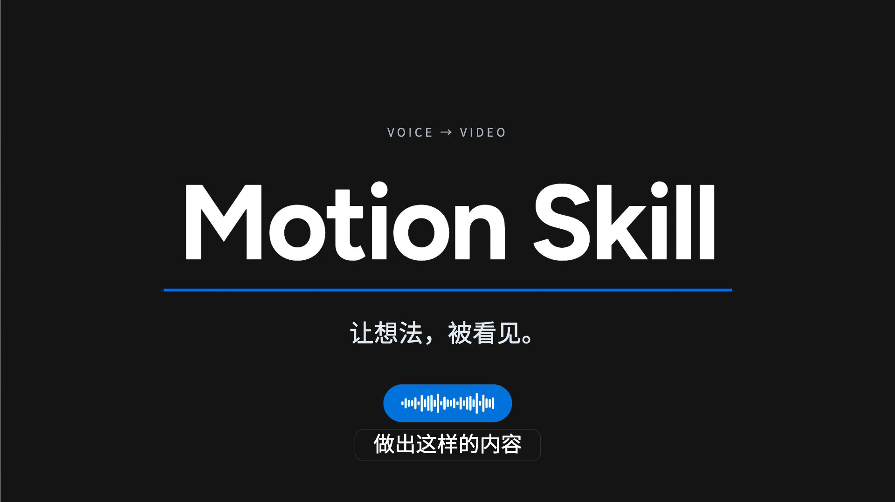

# Motion Skill

**把声音做成可读、连续、有明确结尾的视频。**



**96 项动效机制研究 · 19 个分类 · 5 类语义结构 · 48 秒有声 reference**

这是一套给 Codex / Agent 使用的 Skill 和 Remotion 工程。它组织原声、实拍素材、字幕与 Motion Graphics；由 Agent 理解内容并编排镜头，Python 负责时间与约束检查，Remotion 负责预览和导出。

本 reference 在 **Codex + GPT-6.1 Sol** 中完成（模型名称按作者提供的标注），本地 Whisper 负责转写，Remotion 负责画面渲染。作者参与了视觉方向、实拍补充、ending 与字幕的反馈。它是一个真实迭代案例，不是“一条 prompt 保证任意音频全自动成片”的能力承诺。

## 先看实际结果

- [播放 / 下载 1080p 中文字幕 reference MP4](demo/motion-skill-reference.mp4)
- [可编辑 reference 工程](examples/voice-to-video/README.md)
- [25 条同步字幕 SRT](examples/voice-to-video/captions.srt)
- [96 项机制目录、分类与缩略图](docs/EFFECTS.md)
- [来源与参考者署名](ATTRIBUTION.md) · [许可范围](LICENSE_SCOPE.md)


上图是机制的单帧示意；在本地打开 `studies.html` 可逐项播放 96 项研究。它们是二维/SVG/CSS 研究和近似效果，不是 96 项全新发明，也不是本片用了 96 个效果。

## 可直接复制的提示词

> /motion-video 把这段音频做成“实拍素材混剪＋MG 动效”：具体场景用实拍，抽象关系用动效。保留原声 1×，补上同步底部字幕。片尾放大 **[名称]**，配 **[收尾文案]**，稳定停留至少三秒。素材保留来源；完成后导出有声 MP4 和可编辑工程。

更完整的输入、素材与 ending 模板见 [PROMPTS](docs/PROMPTS.md)。尽量给出受众、唯一带走的结论、画幅和想要的片尾。没有仓库链接就不编造链接。

## 工程里有什么

| 内容 | 核对后的数量 / 状态 |
|---|---|
| 机制研究 | **96 项，19 类**，目录按 ID 对应源码 |
| 通用语义 renderer | **5 类**：collect / connect / compare / evidence / conclusion |
| 导演与工程能力 | [12 项能力矩阵](docs/FEATURES.md)，逐项标明通用模板 / reference / 限制 |
| 本 reference | **7 段语义镜头、25 条字幕、1 张实拍照片、5.4 秒实拍视频** |
| 原声与输出 | 原声 48.064s、1×；1920×1080、30fps、H.264/AAC |
| 历史组合 | 目录保留历史组合记录；当前研究 UI 不开放它们，不计入可用模板数 |

## 运行 reference

准备 Node.js 22+、Python 3、FFmpeg 与已有 Chrome/Chromium。没有内置 ASR、模型、密钥或浏览器下载器。

```sh
npm ci --ignore-scripts
python3 scripts/prepare-reference.py --fetch-stock
npm run check
npm run build
npm run verify:frames
npm run preview
```

打开 `http://127.0.0.1:4341/` 查看可编辑时间轴；`/studies.html` 浏览机制。`--fetch-stock` 会从已署名的 Unsplash / Pixabay 来源下载素材，并准备静音 B-roll。下载文件只留在本机，不进 Git。原始录音未分发；参考工程从已公开、已获发布授权的示范片提取配音副本。

导出：

```sh
npm run render
```

输出在 `examples/voice-to-video/outputs/`。如浏览器未找到，设置 `REMOTION_BROWSER_EXECUTABLE` 为本机 Chrome/Chromium 的路径。首次浏览器渲染仍受平台、字体和资源可用性影响。

## 安装 Skill，制作自己的片子

将整个仓库放到你的 Agent 可读取的 Skill 目录，保持文件结构，显式调用 `/motion-video` 或 `$motion-video`。Codex 的常见安装位置是 `~/.codex/skills/motion-video`；也可以从任何本地目录读取 `SKILL.md`。此步骤不修改 Agent 的全局配置。

```sh
python3 scripts/motion.py doctor --deps "$PWD/node_modules"
python3 scripts/motion.py new --dest /tmp/my-motion-film --deps "$PWD/node_modules"
```

第二条先生成明确标注的**静音结构示例**。真实口播需要已核对的 transcript、story 和字幕数据，再带 `--media`、`--story`、`--transcript`、可选 `--captions` 创建新工程。见 [GETTING_STARTED](docs/GETTING_STARTED.md)。

## 换成你喜欢的配色

欢迎改成自己的视觉语言：

- reference：`examples/voice-to-video/src/theme.json`
- 新片模板：`story.json → brand.blue / brand.ink / brand.paper`
- 96 项研究的主要配色：`assets/runtime/src/studies/palette.json`

仓库附蓝、紫、珊瑚三组起点；材质高光、灰阶和第三方实拍不会被一键自动重着色。配置示例、适用范围和对比度检查见 [CUSTOMIZATION](docs/CUSTOMIZATION.md)。

## 使用时注意

1. **先核对转写。** 专有名词、口误、字幕断句和时标仍需检查；没有绑定 ASR 服务。
2. **保持原声。** 不为凑时长偷偷加速、延后或截断人声。读不完先减屏幕信息。
3. **字幕与大字各司其职。** 底部字幕跟原话走；主文案讲结论。voice 模式默认要求字幕，明确不要时才关闭。
4. **实拍有出处。** 不把素材示意当成用户本人、实际产品 UI、真实业绩或本人经历。
5. **动效为意思服务。** 研究库不自动做语义导演；复杂机位、素材与版式仍要按本片改源码。
6. **检查实际视频。** 规则、构建和 DOM 检查通过不等于观众看懂；要复看声画、字幕与 ending。
7. **发布前脱敏。** 原始音视频、ASR 原件、设备/位置元数据、本机绝对路径、密钥和无关历史不进公开包。

本案例还有两处轻量 ASR 文字修正，未隐藏为“机器逐字零误差”；见 [reference 制作记录](docs/REFERENCE.md)。

## 署名、许可与贡献

**不主张所有技法原创。** 已记录的参考包括 Oreo UI、Paper Shaders、Juan Mora Romero、Jérémie Nallet / Atelier UI、Noor Mtir / Paperlab、Codrops、Kimi 视频参考集、Camera Controls、Theatre.js。逐项对应见 [ATTRIBUTION](ATTRIBUTION.md)。

工具、模板编排层和 reference 工程中由本仓库贡献者持有版权的代码采用 [MIT](LICENSE)，**历史研究档案、字体、依赖、实拍素材与示范片有明确排除范围**，见 [LICENSE_SCOPE](LICENSE_SCOPE.md)。早期 1–64 项逐项出处记录不完整，因此不把研究档案重新授予 MIT，也不把相关技法说成本仓库发明。

欢迎按许可范围 Fork、改配色、优化字幕、改进机位、补来源记录和提交 PR。提交新效果时请附来源、使用范围和实际预览；计数按有独立 ID 的可运行机制记录，不用配色变化凑数。
